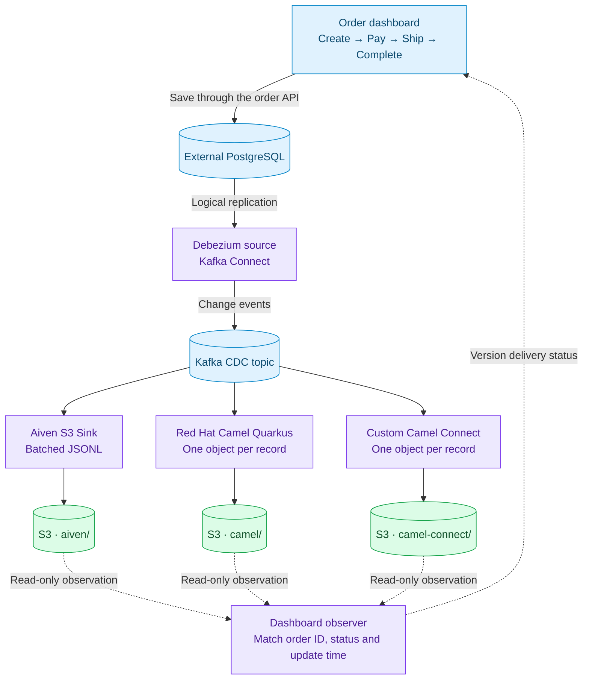

# Streamforge

### PostgreSQL changes. Kafka streams. Three paths to S3.

A GitOps reference implementation for PostgreSQL change data capture on OpenShift. Compare an Aiven S3 sink, a Red Hat Camel Quarkus application, and a custom Kafka Connect sink built with Red Hat Camel libraries—all consuming the same event stream.

**Apache 2.0** · **Central Argo CD** · **Vault + ESO** · **cert-manager** · **Ambient mTLS** · **amd64 + arm64 builds**

[Get started](docs/getting-started.md) · [Architecture](docs/architecture.md) · [Deploy](docs/gitops.md) · [Run the showcase](docs/showcase.md) · [Order dashboard](docs/order-dashboard.md) · [All documentation](docs/README.md)

> **Project status**
> A configurable deployment baseline with reproducible builds and validation tooling. Production use requires qualification against your platform, external services, and support agreements. Public examples intentionally contain non-deployable placeholders.

## How it works



The optional public dashboard uses dedicated Keycloak login and an RHCL Gateway with TLS, Coraza, authentication and rate limits. Dedicated HTTP waypoints protect the dashboard and identity service. [View the web security diagram →](docs/public-dashboard.md)

The three sinks run independently, with separate consumer groups, credentials and object prefixes. Kafka traffic uses native Streams listeners. HTTP waypoints protect Connect REST and Camel HTTP endpoints; **Kafka never traverses a waypoint**. See the [architecture diagrams](docs/architecture.md) for deployment and trust boundaries.

## Choose a showcase

| Profile | S3 writers | Useful for |
| --- | --- | --- |
| `aiven` | Aiven Kafka Connect sink | Comparing batched JSONL exports |
| `camel` | Camel Quarkus application | Inspecting application-managed processing and retries |
| `camel-connect` | Custom Connect sink using Camel | Inspecting Connect-managed offsets with Camel integration |
| `both` | Aiven + Camel Quarkus | A two-implementation comparison |
| `all` | All three | The complete showcase; default |

All modes include the Debezium source and shared Kafka resources. Delivery is **at least once**. Camel writes an object before committing its Kafka offset and uses deterministic topic/partition/offset keys. [Understand retries and recovery →](docs/operations.md)

## Preview in a few commands

Requires Helm 3 and Python 3.9+. This renders examples locally and does not contact a cluster.

```bash
python3 -m venv .venv
. .venv/bin/activate
pip install -r scripts/requirements.txt
make validate
make render MODE=all
```

For a deployment, start with [the setup guide](docs/getting-started.md). Build the four images, populate Vault through your normal secret-management process, and keep environment values in a private repository. The central Argo CD instance combines the public chart with those private values.

## What is included

- Three dedicated KRaft controllers and three brokers; retained block-storage PVCs, replication factor three and minimum ISR two.
- Separate Connect workers for the source and each Connect sink; a standalone Camel Quarkus deployment.
- Vault-backed secret references, listener certificates, verified TLS, SCRAM identities and Kafka ACLs.
- Ambient STRICT mTLS, explicit workload identity policies and HTTP waypoint enforcement.
- Network isolation, disruption budgets, metrics, alerts and guarded GitOps promotion.
- amd64/arm64 image build instructions, smoke checks and a repeatable CDC-to-S3 showcase.

## Find your next step

| I want to… | Read |
| --- | --- |
| Understand the flow and security layers | [Architecture](docs/architecture.md) |
| Prepare the platform and external services | [Getting started](docs/getting-started.md) |
| Configure the chart | [Configuration reference](docs/configuration.md) |
| Know exactly what belongs in Vault | [Vault layout and field inventory](docs/vault-layout.md) · [Secrets and certificates](docs/secrets.md) |
| Build images and deploy through central Argo CD | [GitOps deployment](docs/gitops.md) |
| Compare all three sinks | [Showcase walkthrough](docs/showcase.md) |
| Operate, recover and qualify the system | [Operations](docs/operations.md) · [Validation](docs/validation.md) |

## Support and license

Red Hat Streams, Debezium and Camel provide the platform building blocks. Aiven is a community plugin. The custom Camel Connect adapter is maintained by this project; it is not a Red Hat-distributed connector. Using Red Hat libraries does not confer vendor support on the complete integration. [Platform qualification →](docs/platform-assessment.md)

Project code is licensed under [Apache License 2.0](LICENSE). Dependency and container-image licenses remain their respective owners' terms; see [NOTICE](NOTICE).

Keep credentials, deployment inventories and real endpoint values out of public Git. `.local/` and `environments/private/` are ignored by Git and excluded from the root image build context. [Public repository hygiene and GitHub scanning →](docs/publication-safety.md)
