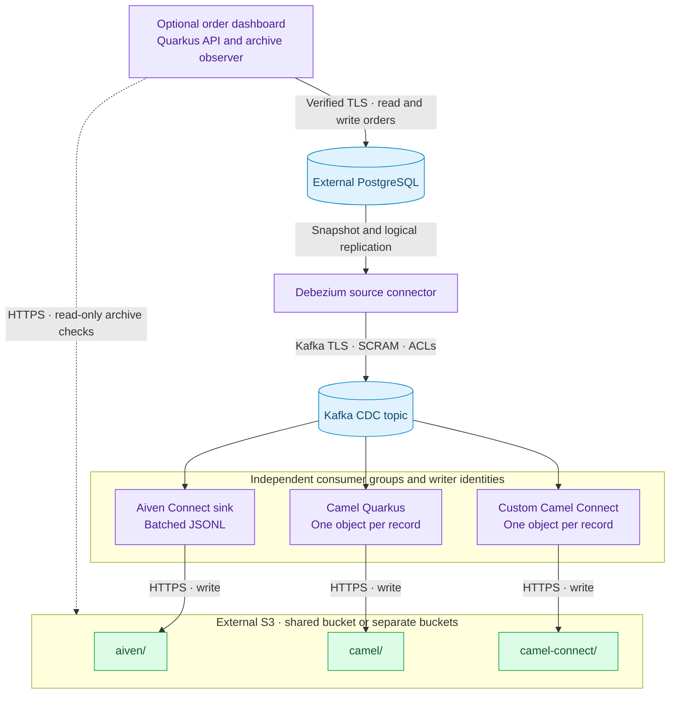
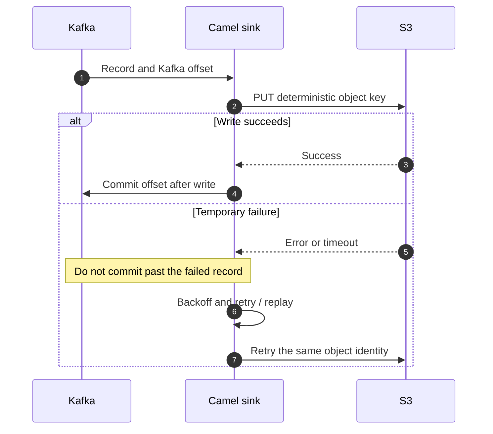
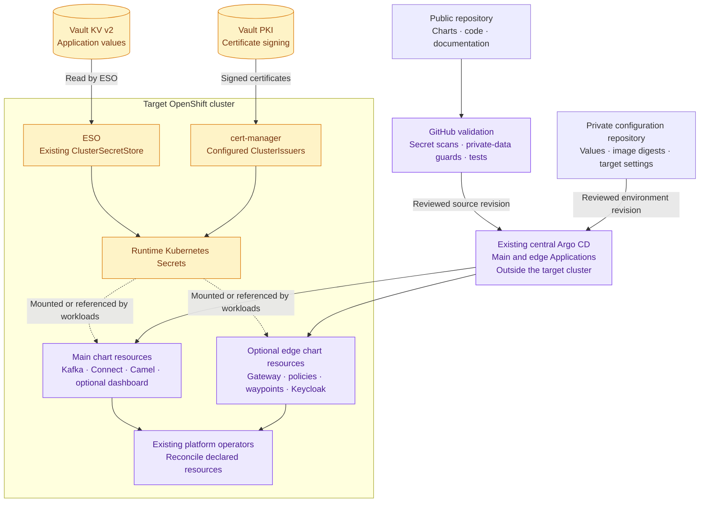
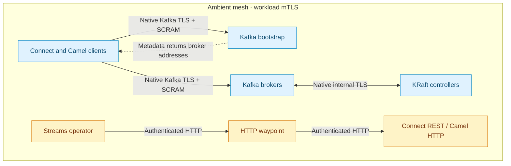

# Architecture

[Documentation](README.md) / Architecture

Streamforge separates event delivery, deployment reconciliation and trust management. Each layer has its own owner and recovery responsibilities.

## 1. From a database change to an S3 object

Debezium captures the selected PostgreSQL table into a shared Kafka topic. Snapshot, insert, update and delete envelopes are retained. Each sink has its own consumer group and S3 credentials, so a slow or failing sink does not advance another sink's offsets.

The diagram shows the shared-bucket showcase with three prefixes. Each sink reads its bucket and endpoint from its own Vault entry, so separate buckets are also supported. Bucket lifecycle, encryption and IAM policies are external responsibilities.

### Why a failed write is retried

The following sequence describes the two custom Camel implementations. Aiven has its own batching/upload lifecycle.

Delivery remains **at least once**. A crash after PUT and before commit can repeat a write. Object versioning can retain repeated versions, and source duplicates may have different Kafka offsets. [Retry details and failure recovery →](operations.md)

## 2. Public implementation, private deployment

Argo CD combines two Git sources. Public Git holds reusable implementation; private Git holds the environment inventory. Passwords and access keys stay in Vault and are materialized by ESO. Git contains secret references only. cert-manager requests Kafka listener certificates through its configured ClusterIssuer. The optional edge chart uses a separate TLSPolicy/ClusterIssuer selection for the dashboard and identity hostnames. The two Applications can consume the same private deployment repository; the public examples also support separate implementation and environment sources.

Argo CD does not provision the external database, S3 bucket, Vault backend, shared operators or central mesh. Those are platform prerequisites. [Deployment guide →](gitops.md)

## 3. Kafka transport and HTTP policy are separate

**Kafka is not routed through a waypoint.** Bootstrap, client-to-broker, replication and controller traffic retain native Streams paths. Ambient ztunnel adds workload mTLS without HTTP proxying of the Kafka protocol. Kafka still verifies SCRAM identities and topic/group ACLs.

Waypoints protect HTTP endpoints and check caller identities. Direct Connect worker HTTP access is also covered so REST forwarding cannot bypass policy. Monitoring callers must be meshed where STRICT mTLS is enforced. External PostgreSQL and S3 connections use verified application TLS; they are not automatically part of the mesh.

| Certificate purpose | Owner |
| --- | --- |
| Kafka client listener DNS certificate | cert-manager and the configured Vault-backed ClusterIssuer |
| Kafka internal broker/controller/operator certificates | Red Hat Streams |
| Dashboard and Keycloak HTTPS listener certificates | RHCL TLSPolicy, cert-manager and the selected ClusterIssuer |
| Ambient workload identities and HTTP waypoint mTLS | Existing mesh CA integration |
| External PostgreSQL and S3 server certificates | External service provider |

[Mesh configuration and acceptance tests →](service-mesh.md)

## 4. Public dashboard security

The optional dashboard has its own HTTPS and identity path. The [detailed edge diagram](public-dashboard.md) shows Coraza, JWT enforcement, rate limiting, dedicated waypoints and signing-key lookup. The [order sequence](order-dashboard.md#what-happens-when-you-click-mark-paid) separates a committed order change from later S3 observation.

## Availability and limits

Three dedicated controllers provide a KRaft quorum; three brokers use replication factor three and minimum ISR two. Retained PVCs, host anti-affinity and disruption budgets protect ordinary failures and maintenance. Two Connect workers provide source-worker failover, while one replication slot still has one active source task.

Host separation does not guarantee storage-backend, zone or site resilience. A three-worker cluster has little maintenance headroom, and shared block storage can remain a common failure domain. Qualify throughput, recovery objectives, retention and vendor support before production. [Platform checklist →](platform-assessment.md)
