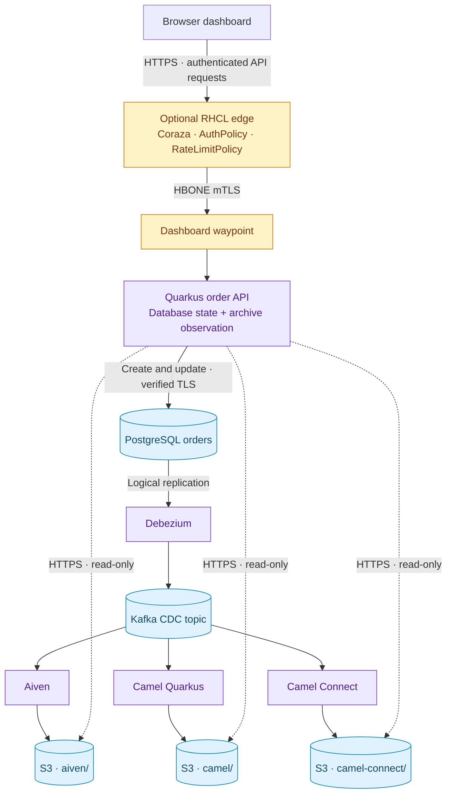
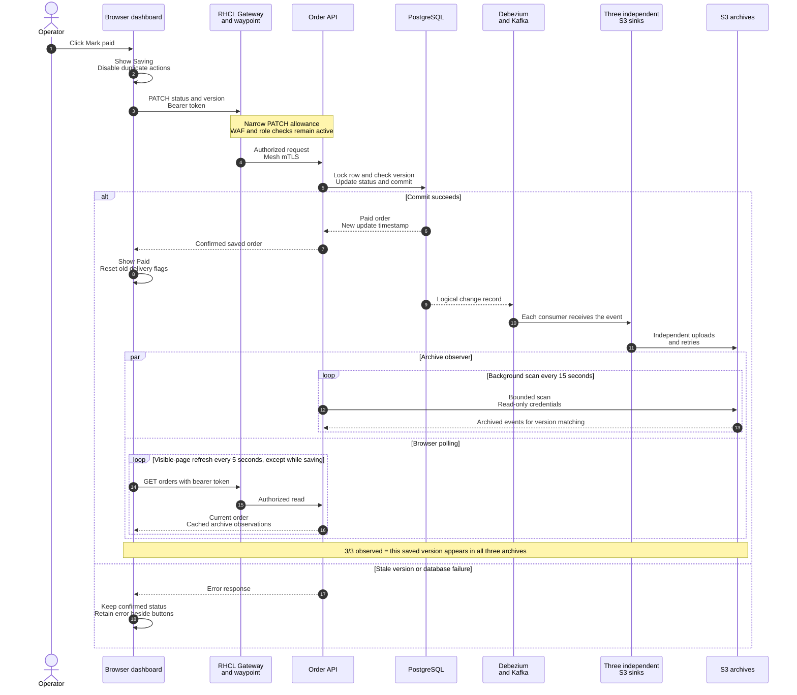

# Order lifecycle dashboard

Turn the CDC pipeline into a hands-on order fulfillment demonstration. Create a synthetic order, mark it paid, ship it, and complete it. The dashboard shows the current PostgreSQL record beside the archived version observed through each S3 sink.



This diagram shows the optional deployed HTTPS flow. Local preview uses in-memory state and simulated delivery; it does not connect to these services. The [identity and edge diagram](public-dashboard.md) expands login and authorization.

## What you can demonstrate

1. **Create an order.** Enter a synthetic customer and an amount. The backend commits to `public.orders`; it does not publish a separate Kafka message.
2. **Follow delivery.** Select the order to compare the three independent archive paths.
3. **Advance its lifecycle.** `created → paid → shipped → completed`. A created or paid order can instead become `cancelled`. Cancellation changes status; the app never deletes an order.
4. **See asynchronous behavior.** An old archived version stops satisfying the new database version until the new event is observed. Batched Aiven JSONL and per-record Camel JSON are normalized by the observer.

Amounts are demonstration values without an assigned currency. The database has no currency column. The order table shows the latest 100 records. Existing rows are preserved; the app performs no schema migration, bulk reset, or automatic data seeding against PostgreSQL.

## What happens when you click Mark paid



A Gateway rejection stops the request before the API; the UI also retains that error. A lost response may leave the outcome uncertain, so refresh before retrying. Saving the business status does not wait for S3, and a late refresh started before the save cannot restore the older UI state.

## Try a credential-free preview

Requires Java 21 and Maven. Preview mode uses in-memory orders and **simulated** delivery delays, clearly labeled in the UI. It does not contact PostgreSQL, Kafka, Vault, or S3. Its sample data disappears on restart.

```bash
mvn -B -ntp -f order-dashboard/pom.xml verify
java -Dquarkus.profile=preview -Dquarkus.http.host=127.0.0.1 \
  -Dquarkus.http.port=8088 -jar order-dashboard/target/quarkus-app/quarkus-run.jar
```

Open `http://localhost:8088`. Preview delivery takes approximately 3, 6, and 12 seconds for the simulated sinks; these are UI fixtures, not performance measurements.

For HTTPS exposure, Keycloak login, Coraza and RHCL policies, see [Public dashboard deployment](public-dashboard.md).

## Prepare real access

The optional app requires `mode: all`, ambient mesh enabled, and the existing `public.orders` showcase schema. Provision a dedicated app account through your normal process. As the database owner, grant its existing role privileges:

```bash
psql service=streamforge-showcase -v app_role=YOUR_EXISTING_APP_ROLE \
  -f showcase/04-grant-dashboard.sql
```

The role needs `CONNECT`, schema `USAGE`, and table `SELECT`, `INSERT`, `UPDATE`. It needs no replication privilege. Do not reuse the CDC account or a database owner.

Provide these fields through Vault; never put values in Git:

| KV v2 logical path | Fields |
| --- | --- |
| `secret/streamforge/dashboard/postgres` | `PG_APP_USERNAME`, `PG_APP_PASSWORD` |
| `secret/streamforge/dashboard/s3/aiven` | `S3_ACCESS_KEY_ID`, `S3_SECRET_ACCESS_KEY` |
| `secret/streamforge/dashboard/s3/camel` | `S3_ACCESS_KEY_ID`, `S3_SECRET_ACCESS_KEY` |
| `secret/streamforge/dashboard/s3/camel-connect` | `S3_ACCESS_KEY_ID`, `S3_SECRET_ACCESS_KEY` |

Each S3 identity needs `s3:ListBucket`, constrained to its configured topic prefix, and `s3:GetObject` under that prefix. It needs no write/delete permission. For the default topic, scopes are `aiven/sf.public.orders/*`, `camel/sf.public.orders/*`, and `camel-connect/sf.public.orders/*`, in each sink's bucket. Match ListBucket prefix conditions to the requested prefix including its trailing slash, for example `aiven/sf.public.orders/`.

ESO reuses connection metadata and CA fields from the existing PostgreSQL and per-sink S3 entries. It retrieves the new read-only S3 credentials separately; the dashboard never mounts sink writer credentials or the CDC password. The existing ESO Vault policy must permit the new paths. PostgreSQL uses `verify-full`; S3 validates server certificates against the corresponding CA bundle. If using an IPv6 literal for `PG_HOST`, include its JDBC brackets, e.g. `[2001:db8::10]`; a DNS name resolving to IPv6 needs no brackets.

## Build and enable through GitOps

The dashboard is the **fifth image**, separate from the four pipeline images. It uses the same pinned Red Hat Quarkus BOM and UBI Java 21 runtime. Build the application before building the container:

```bash
mvn -B -ntp -f order-dashboard/pom.xml verify
# Substitute your repository and release tag.
docker buildx build --platform linux/amd64,linux/arm64 \
  -t YOUR_REGISTRY/streamforge-order-dashboard:YOUR_RELEASE \
  --push order-dashboard
```

In private environment values, enable it with the published multiarch manifest digest:

```yaml
dashboard:
  enabled: true
  image: YOUR_REGISTRY/streamforge-order-dashboard@sha256:YOUR_MANIFEST_DIGEST
  replicas: 1
```

Run production validation and sync through the existing central Argo CD application. This adds four ExternalSecrets, a ConfigMap of prefixes, a ServiceAccount, Deployment, ClusterIP Service, data egress policy, and a mesh policy. The main chart creates no public ingress, credentials, or Kafka ACLs; the optional edge chart supplies HTTPS ingress and identity. The app needs no Kafka or Kubernetes API access. Increment `rotationRevision` after credential or CA renewal; clients read their configuration at startup.

For the first deployment, use your existing Kubernetes authentication to access it:

```bash
oc -n streamforge port-forward service/order-dashboard 8088:8080
```

Open `http://localhost:8088`. With `dashboard.publicAccess.enabled: false`, access is restricted to users authorized to port-forward and the chart denies mesh requests to the app. For HTTPS access, follow [Public dashboard deployment](public-dashboard.md) to enable Keycloak authentication, backend authorization and dedicated waypoint policies. When public access is enabled, backend JWT validation also applies to port-forwarded API requests.

## What delivery states mean

- **Delivered:** an S3 event was observed with the same order ID, status, and `updated_at` version as the current database row.
- **Not observed:** the current version has not been found in the observation window. It may still be processing or be outside the scan limits; this is not proof of data loss.
- **Unavailable / Access denied:** the S3 observer failed, not necessarily the sink writer. No connector configuration or credentials are returned to the browser.
- **Stale scan:** the last successful observation is more than two minutes old.

The observer runs every 15 seconds without overlapping scans. It lists up to 10,000 keys per sink, examines up to 200 objects ordered by modification time from that listing, and reads only objects up to 2 MiB. Each sink scan has a time budget; requests have separate timeouts. It caches observed object ETags to avoid repeatedly downloading unchanged files and retains at most 5,000 order versions. When a limit is reached, the UI marks the scan as bounded. Listings are lexicographic; beyond the listing limit this is **not** a globally newest-object search. Observations are kept in memory and reset when the pod restarts. Historical observations do not guarantee an object still exists later.

This observer is sized for a synthetic showcase, not a warehouse inventory or an end-to-end delivery audit. It does not infer latency from file count or claim exactly-once delivery. It never resets offsets, rewrites existing archive objects, or reads the legacy unprefixed Aiven objects. Use [the complete fixture verifier](showcase.md) for a downloaded event-set comparison.

## Validation

Unit tests cover monetary input, allowed transitions, stale-write protection, archive normalization, and version matching. Build with `mvn -f order-dashboard/pom.xml verify`. Browser smoke checks exercise creation and updates in preview mode. The isolated UI regression suite covers gateway rejection, errors surviving automatic refresh, stale reads racing a save, disabled duplicate submissions, and delivery resetting for a new version. Real end-to-end qualification requires the provisioned app/reader identities and actual external services.

Reproduce the additional checks with the preview running on port 8088:

```bash
python3 order-dashboard/tests/api.py
npm --prefix order-dashboard/tests ci
npx --prefix order-dashboard/tests playwright install chromium
node order-dashboard/tests/browser.cjs
npm --prefix order-dashboard/tests run test:regression
```

Container checks require the local multiarch test image. The PostgreSQL fixture uses a disposable, network-isolated database with local trust authentication and no published ports; it never connects to the external database or provisions project credentials. Its explicit TLS override applies only to that isolated fixture, not the deployment.

```bash
docker buildx build --platform linux/amd64,linux/arm64 \
  -t streamforge/order-dashboard:test order-dashboard
python3 order-dashboard/tests/containers.py
python3 order-dashboard/tests/postgres.py
python3 scripts/validate-dashboard.py
```
