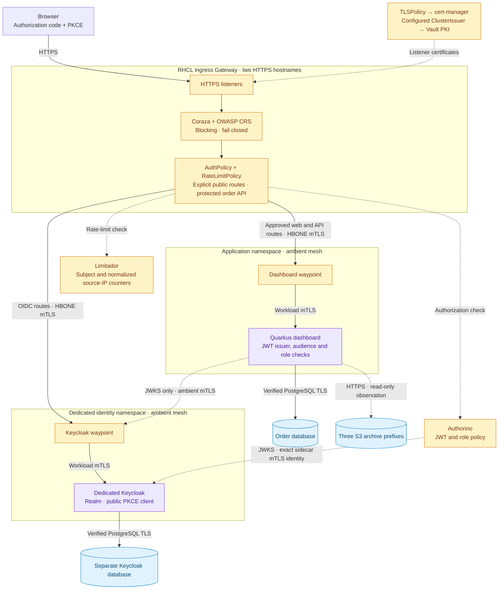

# Publish the order dashboard through RHCL

The optional `streamforge-edge` chart adds a dedicated Keycloak deployment and exposes the order dashboard through an Istio Gateway managed by Red Hat Connectivity Link. Keep environment domains, addresses and private registry references in the private GitOps repository.



The boxes inside the Gateway represent request processing, not separate deployed proxies. Both hostnames pass through Coraza and their route policies. Dotted arrows show supporting lookups or configuration. The explicitly permitted Authorino sidecar path fetches Keycloak signing keys directly; browser and dashboard-to-Keycloak traffic use the identity waypoint. Kafka does not use any of these HTTP waypoints.

## Identity and roles

The browser uses the pinned Red Hat Keycloak JavaScript adapter and authorization code flow with **PKCE S256**. The client is public: there is no browser client secret. Tokens stay in adapter memory; the application does not persist access or refresh tokens in local storage. The adapter manages transient login state. Logout redirects through Keycloak; access tokens have a five-minute lifetime.

`streamforge-viewer` can read orders. `streamforge-operator` can read, create and update orders. The operator role includes viewer. Both RHCL AuthPolicy and the Quarkus backend enforce these roles, the expected public issuer, and the dashboard token audience. Unassigned users cannot access the API. Direct grants, implicit flow and service accounts are disabled for the browser client. Redirect URIs and web origins match the exact HTTPS application origin.

The public web route exposes only named static files and `/auth/config`. The API route is separate and requires a validated bearer token. `/q/*` and internal paths have no public route. A Gateway default-deny AuthPolicy provides an atomic fallback. Explicit public policies permit static content, OIDC login, and Gateway readiness; they do not grant order API access.

## Vault contract

Use the existing ClusterSecretStore and provision these values through your normal process:

| Logical Vault path | Fields |
| --- | --- |
| `secret/streamforge/keycloak/postgres` | `PG_HOST`, `PG_PORT`, `PG_DATABASE`, `PG_USERNAME`, `PG_PASSWORD`, `PG_CA_PEM` |
| `secret/streamforge/keycloak/bootstrap` | `KC_BOOTSTRAP_ADMIN_USERNAME`, `KC_BOOTSTRAP_ADMIN_PASSWORD` |
| `secret/streamforge/keycloak/users/operator` | `KC_USERNAME`, `KC_PASSWORD` |

Keycloak needs a **separate database** and a database role that can manage its schema and migrations. Use a DNS name for `PG_HOST`; it may resolve only to IPv6. PostgreSQL uses `verify-full` and the supplied CA. The chart rejects an inconsistent egress port or unsafe JDBC host/database syntax. It does not create a database, database account, password, Vault value, or client secret.

The operator imports the supplied initial operator username/password and realm configuration once. `KeycloakRealmImport` is **not an ongoing realm reconciler**: changing Vault does not automatically rotate existing Keycloak user passwords or alter an existing realm. Manage subsequent account, client and realm changes through Keycloak's supported administration workflow. The bootstrap account is administrative; use the operator account for the dashboard.

The supplied reference mirrors the existing cluster's Keycloak operator. That operator determines the server image. An upstream Keycloak image is not a Red Hat build merely because the Gateway or dashboard uses Red Hat components. Qualify your selected operator, server image and adapter versions for your support requirements.

## Deployment sequence

1. Build the dashboard with the pinned adapter and backend security enabled in its deployment configuration:

   ```bash
   npm --prefix order-dashboard/frontend ci
   npm --prefix order-dashboard/frontend run build
   mvn -B -ntp -f order-dashboard/pom.xml verify
   docker buildx build --platform linux/amd64,linux/arm64 \
     -t YOUR_REGISTRY/streamforge-order-dashboard:YOUR_RELEASE --push order-dashboard
   ```

2. Configure the edge values in private Git. Set `hostname`, `identityHostname`, `issuer`, the existing `secretStore`, approved PostgreSQL CIDRs, mesh identities, and the verified Coraza **child manifest** digest. Set `dashboardRoutesEnabled: false` while bootstrapping. The chart installs identity in a dedicated namespace; the example [AppProject](../gitops/project.yaml) includes that namespace and the new resource kinds. Configure the [edge Application](../gitops/application-edge.yaml) with your repository revisions and private edge values.
3. Sync the edge application. Confirm ESO, Keycloak, realm import, Gateway, waypoints and TLS certificates are Ready. Pin the new dashboard image digest in the main application's values and enable `dashboard.publicAccess` with matching identity URL, realm, client ID and waypoint name.
4. Sync the main application and verify its API returns 401 without a token. Then set `dashboardRoutesEnabled: true` and sync the edge application. Verify AuthPolicy and RateLimitPolicy are Enforced before announcing availability.
5. Publish the hostname through your DNS workflow. The optional `gatewayAnnotations` values can opt into a platform DNS publisher. Its unauthenticated `GET /health/ready` probe reports Gateway readiness, not database or user-login health.

The `issuer` in edge values selects the ClusterIssuer used by **TLSPolicy** for the two HTTPS listener certificates. It is independent of Kafka's internal listener issuer. TLS private keys are generated and managed by cert-manager; they are never committed to Git.

## Transport and workload isolation

Dashboard and Keycloak Services explicitly set `istio.io/ingress-use-waypoint: "true"`. Each has a dedicated waypoint. The dashboard pod accepts port 8080 only from its waypoint; the waypoint accepts only the ingress Gateway identity and the approved methods/paths. Backend JWT validation also applies through a Kubernetes port-forward. Kafka remains on its native TLS listeners and never traverses these waypoints.

The Keycloak waypoint accepts the ingress Gateway and restricts the dashboard identity to GET on the JWKS path. Authorino in this installation uses a sidecar and bypasses destination waypoints, so Keycloak's transport policy permits **only its exact mTLS identity** directly on port 8080. Keycloak still protects its administration and token endpoints. Authorino verifies the external issuer independently while fetching public signing keys over the internal mesh-protected Service.

Keycloak's operator management probe on port 9000 follows the existing operator pattern: plaintext only on that management port, restricted by NetworkPolicy to the operator namespace and ambient probe addresses. It is never routed publicly. Normal application traffic uses STRICT mTLS.

Coraza is pinned, inspects request bodies, runs CRS in blocking mode, and uses `FAIL_CLOSE`. CRS permits `PATCH` only for the dashboard hostname and exact `/api/orders/<numeric-id>/status` endpoint. Request inspection and JWT/role checks still apply; other paths retain the default method restrictions. The ingress proxy alone receives public HTTPS egress for OCI artifact/CDN fetching; app and identity database egress remain restricted. Quay/CDN IPs are dynamic, so this HTTPS allowance is broader than a fixed provider CIDR. Scope it further with a supported registry egress proxy if your platform requires domain-level restrictions.

## Limits and verification

Defaults are 300 API reads and 60 writes per minute per token subject, plus 1,200 API requests per source address. Static requests and identity requests each have a 120-per-minute source-address limit. Gateway readiness has a separate 1,200-per-minute limit for platform probes. Adjust the values for your demonstration concurrency. Keycloak brute-force protection is enabled as well. Source counters strip the connection port from Envoy’s socket address, preserving IPv6, so new connections share the same IP allowance. A proxy or NAT may cause several users to share that address; authenticated API limits additionally use the token subject.

Validate both negative and positive behavior:

- HTTPS certificate chain and expected hostname; Gateway/HTTPRoute `Accepted`, `Programmed` and `ResolvedRefs`.
- Coraza rejects a harmless synthetic XSS probe while the same normal request succeeds.
- Missing/invalid tokens return 401/403; viewer tokens cannot POST/PATCH; operator login can complete an order lifecycle.
- The configured rate limit produces 429 when exceeded, then recovers after the window.
- Gateway traffic traverses the expected waypoint; direct Gateway-to-pod attempts are denied.
- JWKS lookup works from both the dashboard and Authorino without disabling certificate verification or mesh mTLS.

Run the non-mutating edge regression check after policy changes:

```bash
python3 scripts/check-dashboard-edge.py --url https://orders.example.invalid --ca-file /path/to/root-ca.pem
```

It checks readiness, unauthenticated API rejection, the narrow PATCH allowance, blocked methods and Coraza XSS rejection. It needs no user credentials and changes no orders. An authenticated operator lifecycle remains a separate browser check.

Use `python3 scripts/validate-edge.py` for offline checks, and server-side dry-run against the installed CRDs before deployment. This showcase uses one replica for each new proxy and Keycloak to fit a demo cluster. The Keycloak pod has eviction protection and a PDB; this does not make a single replica highly available.

References: [RHCL policy configuration](https://docs.redhat.com/en/documentation/red_hat_connectivity_link/1.2/html/configuring_and_deploying_gateway_policies/rhcl-config-deploy-gateway-policies), [Red Hat Keycloak JavaScript adapter](https://docs.redhat.com/en/documentation/red_hat_build_of_keycloak/26.2/html-single/upgrading_guide/index), [Quarkus bearer authentication](https://quarkus.io/guides/security-oidc-bearer-token-authentication/).
