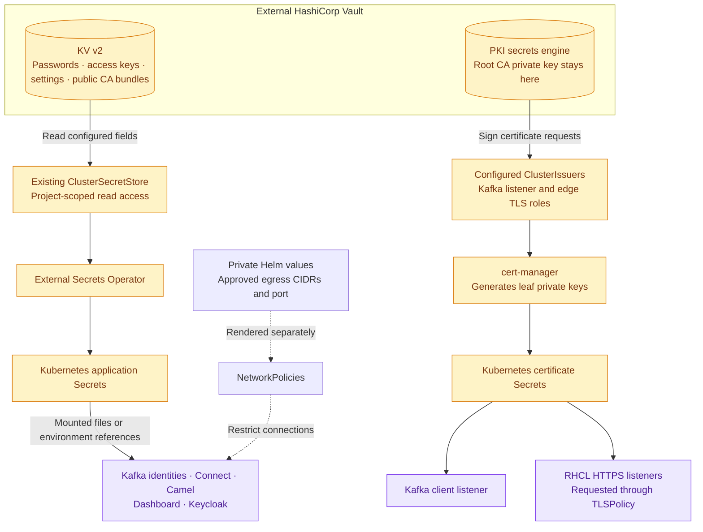

# Suggested HashiCorp Vault layout

[Documentation](README.md) / Vault layout

Use a **KV v2 mount** for application configuration and credentials, with a separate PKI secrets engine for certificate issuance. The examples use mount `secret` and project prefix `streamforge`. These names are suggestions; set `vaultPrefix` in both charts to match your private deployment.

Download the [field-only YAML inventory](examples/vault-layout.yaml) as a provisioning checklist. Every `null` means **supply a real value in Vault**. This is documentation, not an import payload: do not upload nulls or put populated copies in public Git.

## How values and certificates reach workloads



KV trust bundles contain public certificates only. Vault signs certificate requests; cert-manager owns the issued leaf private keys. CIDR metadata does not turn into a NetworkPolicy through ESO: the approved CIDRs must also be present in private Helm values. Streams-managed internal Kafka CAs and the platform's existing mesh identity issuance are separate from this diagram.

## Organize by consumer

```text
secret/streamforge/
├── postgres                    PostgreSQL CDC connection and identity
├── trust                       Kafka listener CA bundle
├── kafka/
│   ├── source                  Debezium Kafka identity
│   ├── aiven                   Aiven Kafka identity
│   ├── camel                   Camel Quarkus Kafka identity
│   └── camel-connect           Camel Connect Kafka identity
├── s3/
│   ├── aiven                   Aiven writer and storage settings
│   ├── camel                   Camel Quarkus writer and storage settings
│   └── camel-connect           Camel Connect writer and storage settings
├── dashboard/
│   ├── postgres                Dedicated order application identity
│   └── s3/
│       ├── aiven               Read-only archive identity
│       ├── camel               Read-only archive identity
│       └── camel-connect       Read-only archive identity
└── keycloak/
    ├── postgres                Dedicated identity database connection
    ├── bootstrap               Initial administrator
    └── users/operator          Initial dashboard operator
```

For separate environments, a prefix such as `streamforge/production` can isolate the same layout. Change both charts, the ESO access policy and your provisioning inventory together. Never share production identities with a demo deployment.

## Path conventions

The mount and API path differ from the key ESO expects:

| Context | Example |
| --- | --- |
| Vault UI | Mount `secret`, secret path `streamforge/postgres` |
| Vault CLI logical path | `secret/streamforge/postgres` |
| KV v2 API/policy data path | `secret/data/streamforge/postgres` |
| ESO `remoteRef.key` | `streamforge/postgres` |
| Chart configuration | `vaultPrefix: streamforge` |

The existing ClusterSecretStore supplies the mount, KV version and Vault authentication. Do not prepend `secret/data/` to chart remote keys. See [HashiCorp's KV v2 documentation](https://developer.hashicorp.com/vault/docs/secrets/kv/kv-v2) and the [runtime field contract](secrets.md).

## Required fields

| Entry | Field names | Purpose |
| --- | --- | --- |
| `postgres` | `PG_CDC_USERNAME`, `PG_CDC_PASSWORD`, `PG_HOST`, `PG_PORT`, `PG_DATABASE`, `PG_CA_PEM` | CDC connection using verified PostgreSQL TLS |
| `trust` | `KAFKA_CA_PEM` | Root/intermediate bundle for Kafka's client listener |
| `kafka/source` | `KAFKA_SOURCE_PASSWORD` | Source SCRAM password |
| `kafka/aiven` | `KAFKA_AIVEN_PASSWORD` | Aiven SCRAM password |
| `kafka/camel` | `KAFKA_CAMEL_QUARKUS_PASSWORD` | Camel Quarkus SCRAM password |
| `kafka/camel-connect` | `KAFKA_CAMEL_CONNECT_PASSWORD` | Camel Connect SCRAM password |
| `s3/aiven` | `S3_AIVEN_ACCESS_KEY_ID`, `S3_AIVEN_SECRET_ACCESS_KEY` | Aiven writer identity |
| `s3/camel` | `S3_CAMEL_QUARKUS_ACCESS_KEY_ID`, `S3_CAMEL_QUARKUS_SECRET_ACCESS_KEY` | Camel Quarkus writer identity |
| `s3/camel-connect` | `S3_CAMEL_CONNECT_ACCESS_KEY_ID`, `S3_CAMEL_CONNECT_SECRET_ACCESS_KEY` | Camel Connect writer identity |

**Each** `s3/*` entry also needs `S3_BUCKET`, `S3_ENDPOINT`, `S3_REGION`, `S3_PATH_STYLE` and `S3_CA_CERTIFICATE_PEM`. Use an HTTPS endpoint with no credentials embedded in the URL. Store addressing mode as the string `true` or `false`; Aiven requires `true` for its custom endpoint. Store PEM bundles as multiline strings. Trust the actual provider's CA; it need not be the Kafka CA.

Provision buckets externally. You can use one bucket with separate `aiven/`, `camel/` and `camel-connect/` prefixes, or a bucket per sink. Restrict each writer to its own objects. Prefixes are set in private Helm values; **`S3_PREFIX` is not a consumed Vault field**. The dashboard's read identities need ListBucket/GetObject for their corresponding archive prefixes, not write access.

### Optional dashboard

| Entry | Field names |
| --- | --- |
| `dashboard/postgres` | `PG_APP_USERNAME`, `PG_APP_PASSWORD` |
| `dashboard/s3/aiven` | `S3_ACCESS_KEY_ID`, `S3_SECRET_ACCESS_KEY` |
| `dashboard/s3/camel` | `S3_ACCESS_KEY_ID`, `S3_SECRET_ACCESS_KEY` |
| `dashboard/s3/camel-connect` | `S3_ACCESS_KEY_ID`, `S3_SECRET_ACCESS_KEY` |

The dashboard uses a dedicated PostgreSQL account with SELECT/INSERT/UPDATE on `public.orders`. It reuses the host, port, database and CA from `postgres`, and the endpoint/bucket/region/CA fields from each existing `s3/*` entry. Do not duplicate those fields under `dashboard/*`. See [dashboard provisioning](order-dashboard.md).

### Optional Keycloak / HTTPS dashboard

| Entry | Field names |
| --- | --- |
| `keycloak/postgres` | `PG_HOST`, `PG_PORT`, `PG_DATABASE`, `PG_USERNAME`, `PG_PASSWORD`, `PG_CA_PEM` |
| `keycloak/bootstrap` | `KC_BOOTSTRAP_ADMIN_USERNAME`, `KC_BOOTSTRAP_ADMIN_PASSWORD` |
| `keycloak/users/operator` | `KC_USERNAME`, `KC_PASSWORD` |

Give Keycloak a **separate database and database owner account** for schema migrations. The bootstrap administrator and dashboard operator are separate users. The public OIDC client uses PKCE, so no client-secret field is required. Realm import initializes accounts once; later Vault edits do not automatically change existing Keycloak passwords. See [public dashboard deployment](public-dashboard.md).

## Network metadata

You may store `PG_EGRESS_CIDRS` alongside `postgres` and `S3_EGRESS_CIDRS` alongside each `s3/*` entry as provisioning metadata. For IPv6 destinations, use approved IPv6 CIDRs, including `/128` for a single address. Keep actual addresses out of this public repository.

These fields are **not consumed by ESO workload Secrets**. NetworkPolicy needs separately rendered values: `network.postgresCidrs` and `network.s3Cidrs.<sink>` in the main chart, and `network.postgresCidrs` in the edge chart. Keep the Keycloak database policy aligned with its actual destination; it may differ from the CDC database. The [network import guide](configuration.md#import-network-settings-from-vault) describes preparing private values. `PG_CA` and `PG_CONNECTION_STRING` are not required by these charts.

## Provisioning and access

1. Provision database accounts, buckets and storage identities through your normal administrative workflow.
2. In the Vault UI, create the entries above with the exact case-sensitive field names. Do not append `=` to field names. Store nonempty values, and keep Kafka passwords single-line.
3. Grant the existing ESO identity read access only to the project paths it needs. For this example prefix, the policy data path is `secret/data/streamforge/*`; split policies further by consumer where your platform supports it. Avoid broad access to unrelated projects.
4. Configure private Helm values with the existing ClusterSecretStore and ClusterIssuer names, approved CIDRs and image digests. No Vault token belongs in chart values.
5. Check ExternalSecret Ready conditions without dumping Secret objects or resolved connector configuration. Rotate consumers as described in [Secrets and certificates](secrets.md#rotation).

Keep the Vault root CA **private key in PKI**, never in these KV entries. cert-manager owns issued TLS private keys and Kubernetes certificate Secrets. The KV fields ending in `CA_PEM` contain public trust bundles only. This guide neither creates credentials nor supplies real cluster values.
